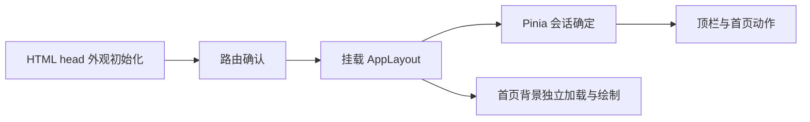

# 前端整理分支提交与变更说明

## 1. 对比范围与阅读方式

本文于 2026-10-27 编写，描述 `lylighte/feat-frontend` 相对于分支共同基点的实际提交与最终净变化，供代码审查和后续接续使用。

| 项目 | 固定值 |
| --- | --- |
| 对比分支 | `lylighte/feat-frontend` |
| 对比基点 | `39f4bb127f2f02393f152172079e828802e7da8c`，上游 dev 的 `fix: scope webhook endpoint form bindings` |
| 内容快照 | `93ab991`，`fix: preserve home gutter width beneath the hero background` |
| 独有提交 | 32 条，包含 1 条同步上游的合并提交 |
| 最终净变化 | 140 个文件；新增 40、修改 100、删除 0；增加 8,842 行、删除 1,967 行 |
| 前端范围 | 89 个非测试前端文件、43 个测试及 fixture 文件 |
| 其他范围 | 根规范和 doc 共 3 个文件、已跟踪的历史验收记录 5 个文件 |

基点由 `git merge-base upstream/dev 93ab991` 确认，并核对了上游 dev 的实际提交。分支早期曾重排到 `75d7066`，之后通过 `7f669a0` 合入 `39f4bb1`；本文以目前已同步的共同基点为准，不把上游 PR #16 的密码策略、账号删除、后端或 SDK 内容重复算作这次前端整理。

本快照相对基点没有 `skin-backend/`、`python-sdk/`、`testdata/` 或 `element-skin/src/api/` 的净改动，也没有修改前端依赖声明或锁文件。本文新增的文件本身及后续批次不计入上表；后续增量应单列，避免静态统计随描述混动。

复核命令：

```powershell
git merge-base upstream/dev 93ab991
git log --reverse --oneline 39f4bb1..93ab991
git diff --shortstat 39f4bb1 93ab991
git diff --name-status 39f4bb1 93ab991
```

提交历史解释“如何到达当前实现”，模块说明解释“最终保留什么行为”。例如 `a53d094` 的首页取消预留方案已经由 `93ab991` 修正，不能将前一个提交单独当作最终效果。

## 2. 整体目标与阶段状态

本分支收敛会话状态、应用壳布局、公共设计变量、基础组件、表单关闭与保存语义以及动效。技术栈仍为 Vue 3、Pinia、Element Plus、Tailwind CSS 和现有 API／存储层；没有切换组件库，没有引入通用 useQuery 数据层，也没有借前端整理改变后端材质归属等业务规则。

| 阶段 | 当前实际内容 | 状态与边界 |
| --- | --- | --- |
| 阶段 0 | 冻结会话重构前的行为与验证清单 | 已完成，属于基线记录 |
| 阶段 1 | 将登录会话移到 Pinia，迁移消费者和相关测试 | 已完成 |
| 阶段 2 | 应用壳和首页流式布局、顶栏加载、首屏外观初始化、邮箱域名组件 | 已闭环；不等于全部后续视觉问题都不存在 |
| 阶段 3.1 | 变量、组件、弹窗、命令及页面入口清点 | 已完成扫描，后续沿用该结果，不另做同目标首轮扫描 |
| 阶段 3.2 | 设计变量集中，清理旧调色板与无用样式 | 已完成 |
| 阶段 3.3 | 基础 UI 与公共布局组件语义收敛 | 已条件闭环；卡片阴影按实际 props 区分，表格内横向滚动属于明确例外 |
| 阶段 3.4 | 弹窗关闭、表单草稿、显式保存、页面离开保护及锁滚动补偿 | 已条件闭环；业务例外继续记录 |
| 阶段 3.5 | 动效变量、首页整组入场、卡片错峰、管理材质首载占位修正 | 已闭环 |
| 独立修正 | 首页连续缩放背景闪烁；首页背景与滚动槽的布局关系 | 已实现；用户确认不再闪烁，滚动槽修正版的逐项视觉结果仍以人工记录为准 |
| 阶段 3.6 | 将统一规则推广到五处详情和其他页面 | 本快照仅有方案，尚未开始产品实现 |
| 阶段 4 | 统一首载、刷新、空态、错误、竞态及缓存协调 | 尚未实施；本分支没有以零散修正冒充全站读取生命周期已完成 |

原始验收和逐轮反馈保留在 [阶段 3 梳理文档](阶段3组件与交互梳理.md)。该文档里的历史未勾项不由代理补勾；工程检查、用户条件放行及逐项视觉通过分别表述。

## 3. 会话状态与应用启动

### 3.1 会话单一来源

新增 `src/stores/session.ts`，集中维护 `user`、`authReady` 和 `generation`。页面和布局通过 `useSessionStore()`／`storeToRefs()` 使用会话，不再通过祖先传递另一份用户状态。

- `fetchMe()` 读取已有 `getMe()` wrapper，并按 generation 判断响应是否仍属于当前会话。
- `clearSession()` 递增 generation，清空用户、头像关联及未读提示，并使会话初始化状态确定。清空后的旧请求不能把用户重新写回。
- `authReady` 与“是否登录”分开：尚未确定会话时，不提前展示错误的登录／注册或用户动作组。
- 登录、注册、个人资料、角色、衣柜、通知及 OAuth 页面迁移到同一会话来源；主题的 `isDark` 注入是独立展示依赖，不是保留第二套会话实现。

App.vue 只组合 AppLayout 与 RouterView；main.ts 安装 Pinia、路由和组件库。HTTP cookie、401 处理与 API wrapper 契约沿用基点，不在业务页复制 token 刷新流程。

### 3.2 首次绘制前确定主题和页面背景

新增 `storage/appearance.ts` 和 `vite/appearanceBootstrap.ts`。主题读取、系统偏好和页面标记由存储层提供，Vite 将同一启动逻辑及初始样式提前输出到 HTML head。



首页通过 `is-home-page` 标记使用首页底色，普通页面使用对应主题底色；首次路由确认后再挂载，避免短暂按首页模式渲染仪表盘。之后成功的路由切换同步更新页面标记。存储不可用时仍能按系统偏好启动和手动切换主题。

这解决启动期的错误主题／错误页面底色闪现，不表示背景图片或自定义头像变成同步资源。

## 4. 应用壳、顶栏和首页

### 4.1 壳与公共布局

AppLayout 负责页头、导航、主内容、抽屉和页脚；页面负责自身内容。首页页头、正文和 footer 在一屏 AppShell 中用普通流式布局分配空间。首页唯一 fixed 层为纯背景 Canvas；移除了标题、按钮的视口坐标定位及其高度联动计算。

页脚提取到 AppFooter，保留首页／普通页面的用途区别。ActionBar、CardActions、PageHeader、SearchBar 收敛对齐、换行、间距及属性透传，页面逐步改用已有组件，而不是为每页另造工具栏。

### 4.2 顶栏的加载和导航几何

- 头像、主题和通知动作按同一会话确定状态出现；不再先出现一个不完整的动作区挤动其他控件。
- 自定义头像已配置但仍加载时保留头像占位，避免先显示用户名首字母，再换成自定义头像。未配置头像的字母头像仍可直接显示。
- 自定义头像需要异步读取和生成，晚于其他顶栏元素出现属于已记录的加载边界，没有用错误字母头像掩盖等待。
- 通知按钮保持纯图标结构。未读标记绝对定位，不占横向布局；清除空插槽文字 span 带来的图标偏移。
- 桌面导航以品牌、菜单和账号操作区实际测量决定是否有足够安全间距。ResizeObserver 同时跟踪相关节点；从认证页返回、账号文字和菜单变化都能重新判断，不只依赖 window resize。
- 窄屏保留抽屉导航；入口仍沿用细粒度权限及当前导航配置。

### 4.3 首页按钮与入场

HomeView 按会话确定结果渲染一个“进入个人面板”，或“登录账号／即刻注册”两项动作。标题、副标题及按钮外框位移共用一个父级入场状态；文字渐入单独作用于文字层，避免祖先 opacity 影响毛玻璃采样。

毛玻璃背景位于按钮 `::before`，按钮本体保持透明；背景层使用 blur 与 saturate，clip-path 限定圆角区域。普通描边和旧 inset 环不恢复，键盘 focus-visible 仍有可见焦点。主按钮蓝色 16% 与次按钮白色 12% 的着色变量仍存在。

2026-10-27 新反馈已确认：着色确实应用，关闭首页大图后可感；不同背景会明显压弱颜色识别。对照 4.1.0 与当前 CSS，在同一灰底的隔离采样中，主按钮两者均为 RGB(131,146,162)，次按钮均为 RGB(157,157,157)。因此当前待讨论的是无边框条件下的着色对比度，而不是颜色层漏渲染；本快照没有擅自增加着色强度。

### 4.4 背景 resize 与滚动槽

此前 resize 事件立即重设绘图缓冲区，下一绘制又可能被限帧跳过，造成背景短暂露底。依据 PR #21 的核心方案，事件现在只标记待更新，下一 RAF 合并尺寸变化，在同一帧重设并重绘；尺寸和有效 DPR 未变时不重复分配。保留本分支的主题底色、首次预热以及启动／更换画布后的及时绘制。轮播和全景旋转不因 resize 重置进度。

PR #21 并非整条合并：本地适配其核心尺寸调度和回归，CI、依赖固定、独立验证包等仍属于原 PR 的范围。

首页灰条的初版处理 `a53d094` 仅取消视口预留，在临界宽度改变 nav 显隐，已由 `93ab991` 修正。最终规则为：操作页在视口保留 stable；首页视口 auto，AppShell 在 overflow hidden 下保留同宽 stable。背景可铺满视口，内容宽度仍与操作页一致。不手算滚动条宽度，也不改变普通页面的滚动主体。

## 5. 设计变量和基础组件

### 5.1 变量与样式职责

`assets/styles/tokens.css` 集中颜色、文字、边框、间距、圆角、阴影、控件与弹窗尺寸及动效参数。appearance.css 负责首帧基础色和页面标记，element-overrides.css 负责 Element Plus 内部结构映射，组件 scoped CSS 只承担必要的稳定尺寸、结构或复杂效果。

清理旧 Vue 调色板、无匹配节点的 App 示例 CSS 和重复页面规则；不为旧变量保留长期别名。Element Plus 某些变量在控件自身声明，因此输入框背景、文字和边框等也映射到控件层，避免只改根变量却未生效。

### 5.2 基础语义

| 组件 | 最终变化 | 需要保留的边界 |
| --- | --- | --- |
| UiButton | 收敛 primary／secondary／tertiary 与 neutral／primary／success／warning／danger；统一尺寸、图标、disabled、loading 和焦点；禁用链接移除 href 与键盘可达入口 | 仍有加载时隐藏正文的呈现，文字与刷新图标统一属于 3.6.5，不宣称已解决全站刷新按钮闪烁 |
| UiCard | 默认 shadow=never；只有显式 hover／always 才按用途显示阴影；padding 分档 | hoverable 位移与阴影 props 是不同能力，不把所有卡片强制变为浮起卡片 |
| UiDialog | form／wide-form／viewer 尺寸，统一关闭按钮和关闭流程，传递 busy／dirty／关闭状态 | 业务草稿由页面或对应表单持有；不把所有对象编辑强制变成整表保存 |
| UiSegmented／UiOptionCard | 单选及选项卡使用现有模型与语义色，减少独立深浅色硬编码 | 不替代所有业务控件，也不改变数据值 |
| UiViewerLayout | 统一预览与信息双栏的基础结构和响应式规则 | 五处详情的完整标题、标识符、短视口及危险动作区推广仍在 3.6 |
| PageHeader／ActionBar／CardActions／SearchBar | 统一页头、动作区和搜索区的对齐、换行及组件属性 | 表格内部横向滚动允许存在，整页溢出与操作遮挡另行处理 |

角色页的“绑定正版／导入／新建”等入口按主次和动作性质重新呈现，弱化不必要的大面积渐变。此处是语义和样式收敛，不是改动相应业务 API。

### 5.3 邮箱域名组合控件

EmailSuffixInput 沿用 Element Plus 输入框 append 区域中的 Select，去掉手工重复包装造成的嵌套边框。允许列表存在时默认选择一个合法域名，域名部分只选择，不开启 filterable 输入；本地部分仍正常编辑。注册／重置邮箱等页面复用同一逻辑，后端邮件策略不变。

## 6. 弹窗、草稿、离开保护与保存

### 6.1 分类不是按“是否对象”一刀切

扫描记录区分业务性质、提交方式和草稿归属：角色／材质详情可以逐项生效；站点设置虽然也是对象编辑，仍刻意保留表单式显式保存；创建、上传、写公告等先形成草稿再提交。应用材质到角色属于详情中的独立命令，选择目标不立即应用，也不使整个详情变成待保存表单。

### 6.2 关闭契约

- 显式取消和右上角关闭表示放弃当前未提交输入；关闭后按对应流程清理。
- 有草稿时，遮罩点击和 Esc 先询问是否放弃；没有修改时可正常关闭。
- busy 或确认关闭正在进行时，阻止重复提交和不安全的关闭。
- UiDialog 用生命周期标识保护异步确认和 closed 回调，旧弹窗的离场不能清理快速重开的新表单。
- 已经成功的逐项修改不会因为关闭详情而回滚；取消确认只针对当前命令。

### 6.3 页面级未保存保护

新增 useUnsavedChangesGuard，与已有 useDirtySnapshot 配合。页内离开和改变对象参数时使用统一放弃确认；重新加载配置有专门文案。刷新、关闭标签及地址栏导航通过 beforeunload 使用浏览器原生提示，只有 dirty／busy 时安装监听，不承诺浏览器允许自定义提示文本或任意自动保存。

站点设置按 site／security／auth 分组维护草稿及成功后的基线，保存一组不会清掉其他组。邮件、彩蛋、Fallback、首页媒体等显式保存页面接入各自边界；并未把它们转换成逐项自动保存。

### 6.4 首页媒体和上传的特殊流程

首页媒体的编辑、启用与排序要保存配置才生效，上传／删除立即生效。父页面草稿与局部媒体编辑器分开，避免局部取消清空父草稿；处理部分成功及失败后的保留。存在未保存配置时先保存或明确放弃，再执行立即生效的上传／删除。

材质上传继续使用弹窗；取消后清理已选文件、预览对象 URL 和表单，提交失败保留可重试内容，成功后按流程更新。没有把上传改成独立页面，也没有实施 skinview3d fork 或独立披风渲染。

新建角色输入长度从 32 对齐现有后端的 16，并提示 1–16 位英文字母、数字和下划线。没有借文案修正将后端改为新的命名规则。

### 6.5 危险动作和锁滚动

部分清绑定命令明确只解除角色绑定，不删除材质；未绑定时禁用对应清除。管理角色清除完成后同步当前详情、列表行和预览。其他详情中的相同命令仍存在差异，已列入 3.6，不将代表页面修复误算为全站完成。

Element Plus 锁滚动会向 body 写入滚动条宽度补偿；本分支对 Dialog／Drawer、MessageBox、ImageViewer 三种锁定 class 统一覆盖，避免在已有预留上重复扣宽。嵌套浮层关闭时仍保留父层锁定，普通页面补偿和首页 AppShell 预留分别验证。

## 7. 动效和加载呈现

统一常用时长 120／180／320／400ms、内容位移 8／12px 及小幅 hover 位移；减少动态效果遵循系统／浏览器 prefers-reduced-motion，相关动效归零或静态呈现，没有新增站内偏好入口。

移除普通操作型组件不必要的位移和大范围 transition: all；保留明确用途的个人资料展示头像悬停效果，并限制到支持 hover 且未请求减少动态效果的环境。

角色、衣柜、公共皮肤库、管理角色和管理材质的卡片恢复逐项入场：页头／工具栏与卡片分开，卡片延迟根据数量分配并限制总延迟，避免长列表等待过久。刷新保留旧节点时不为同一张卡片无意义重播入场。

管理材质页删除固定 8 张浅色手写骨架及独立加载状态，使用稳定最小高度区域和现有局部 loading；首次成功为空才显示空态，已有结果刷新失败时保留旧列表与明确错误。

通知空态在更新期间消失、个人 OAuth 卡片收缩及临时滚动条等剩余问题属于阶段 4 的读取生命周期；按钮自身的文字与图标切换属于 3.6.5。两者已分开登记，本快照没有统一全站数据加载。

## 8. 完整提交记录

以下按 Git 提交顺序列出相对基点独有的 32 条记录。英文标题保持原样，中文说明描述其主要意图和最终状态。

| 提交 | 日期 | 原始标题 | 内容与状态 |
| --- | --- | --- | --- |
| `675374f` | 10-23 | add: frontend session refactor baseline checklist | 阶段 0 的会话重构基线和验证边界 |
| `e52a495` | 10-23 | refactor: move session state to pinia store | 会话 store、消费者及相关回归迁移 |
| `d74584d` | 10-24 | refactor: simplify page shell and home layout | 应用壳、首页流式内容和玻璃按钮分层 |
| `8708f67` | 10-24 | docs: record stage two layout acceptance | 阶段 2 布局记录及首页约束同步 |
| `4bf7880` | 10-24 | fix: align email suffix selector borders | 邮箱域名组合输入框边框统一 |
| `31d856f` | 10-24 | fix: restrict email suffix selection to preset domains | 域名仅选合法选项，不接受自由输入 |
| `c6eb926` | 10-24 | fix: stabilize header loading and navigation geometry | 顶栏加载和测量型导航生命周期 |
| `35c2c46` | 10-24 | docs: trace refresh bootstrap flicker | 首屏刷新链路排查及验证说明 |
| `ced1cd4` | 10-24 | fix: initialize appearance before app rendering | HTML head 外观初始化及路由挂载时序 |
| `cc28b25` | 10-24 | fix: center notification icon independently of unread dot | 纯图标和独立未读标记，移除空 span 偏移 |
| `1389b9d` | 10-24 | fix: avoid fallback avatar flash while loading | 已配置头像等待期间不显示错误字母头像 |
| `cf024a7` | 10-24 | docs: close stage two manual acceptance | 阶段 2 人工记录及加载边界 |
| `c8c3a6b` | 10-24 | docs: inventory stage three components and interactions | 阶段 3 组件、弹窗和命令扫描 |
| `5dbfdea` | 10-24 | refactor: centralize frontend design tokens | 统一设计变量与 Element Plus 映射 |
| `a8bb9ff` | 10-24 | refactor: unify base UI component semantics | 基础 UI 和公共布局组件语义、调用迁移 |
| `fc652b3` | 10-25 | fix: unify dialog dismissal and form lifecycles | 弹窗关闭来源、提交保护与表单生命周期 |
| `20630eb` | 10-25 | fix: protect form drafts and explicit save flows | 未保存草稿、显式保存及页面离开保护 |
| `f603cde` | 10-25 | fix: prevent overlay scroll locks from shrinking page layouts | 各类浮层与嵌套锁滚动补偿 |
| `001fd35` | 10-25 | docs: outline skinview3d work and frontend closure status | 库工作初步计划及前端范围，未实施库改造 |
| `d2a39f5` | 10-25 | docs: close phase 3.4 with accepted conditions | 3.4 条件闭环与业务例外 |
| `7f669a0` | 10-25 | chore: merge upstream dev before motion cleanup | 同步 `39f4bb1`；其已有后端变更不计入本报告净变化 |
| `8620a36` | 10-25 | refactor: unify interface motion and home entrance | 动效变量、普通控件动效和首页整组入场 |
| `b0fc5bc` | 10-26 | fix: restore intentional profile avatar hover motion | 恢复有明确意图的资料头像悬停 |
| `6f95183` | 10-26 | fix: separate card entrances from page header motion | 页头和卡片入场分离，恢复数量受限的错峰 |
| `8b71187` | 10-26 | docs: define refresh controls and unsaved field rollout | 刷新入口、字段 dirty 及阶段边界方案 |
| `575d122` | 10-26 | fix: replace admin texture skeleton with stable list loading | 移除固定骨架，稳定管理材质加载区域 |
| `2f115b5` | 10-26 | docs: close phase 3.5 and audit viewer dialog semantics | 3.5 闭环、五处详情审查与风险清单 |
| `8d2be5e` | 10-26 | docs: consolidate phase 3.6 implementation plan | 3.6 分批顺序、验收要求及阶段 4 边界 |
| `6a6f440` | 10-26 | fix: redraw hero background within the resize frame | 适配 PR #21 核心修复，保留首帧预热 |
| `7ab8aae` | 10-26 | docs: close hero resize flicker follow-up | 独立 resize 修复批次收尾记录 |
| `a53d094` | 10-26 | fix: remove the unused home scrollbar gutter | 初版仅释放首页视口槽，后被发现影响临界 nav |
| `93ab991` | 10-26 | fix: preserve home gutter width beneath the hero background | 最终将首页等宽预留移到 AppShell，保持背景完整覆盖 |

## 9. 工程验证、人工验收和未完成事项

快照最新完整前端检查为 **62 个测试文件、682 项测试通过**；类型检查和生产构建通过。新增用例覆盖会话代际、外观初始化、控件语义、弹窗关闭与快速重开、草稿保留、失败路径、浮层嵌套锁定、动效偏好、卡片错峰和背景 resize。

重要修正均有针对旧实现的失败证据：resize 首轮回归 10 项中旧实现失败 8 项；首页槽初版的 4 项回归捕获旧 stable，随后针对等宽 AppShell 的 5 项回归又捕获“根槽取消但未补内容预留”的遗漏。全量通过不能替代临界窗口、GPU 或真实素材视觉检查。

| 项目 | 目前结论 | 后续位置 |
| --- | --- | --- |
| 首页连续缩放闪烁 | 用户已确认不再闪烁 | 保留 resize 回归，不将 PR #21 全部内容视为已合并 |
| 首页槽与 nav | 修正版实现及隔离技术测量完成；人工逐项结果未补填 | 原梳理文档第 31 节 |
| 首页按钮着色 | 颜色层生效，背景压弱辨识；边框无需恢复 | 独立视觉调整建议，待明确着色强度 |
| 五处角色／材质详情 | 已审查，权限入口、操作范围、请求目标、busy、失败处理及布局尚需推广 | 3.6.1—3.6.4 |
| hash／UUID 展示 | 部分已改为只读块，仍有截断胶囊等不一致 | 3.6.4，不把“看起来像输入框”当作可编辑能力 |
| 刷新按钮文字和图标 | 规则已定，调用未全量迁移 | 3.6.5 |
| 字段未保存提示 | 分组和离开保护已实现，字段级样板未做 | 3.6.6 |
| 首页媒体中间宽度等 | 页头／操作区仍需页面级推广 | 3.6.7 |
| 通知及 OAuth 刷新空态／高度 | 已登记，尚未统一 | 阶段 4 |
| 材质重复上传、公开及删除归属 | 确认涉及后端模型和管理语义，不能前端改名掩盖 | 上游 Issue #22，独立工作 |
| skinview3d／Three.js／披风 | 只有初步计划，上传仍用弹窗 | 独立后续库工作 |

3.6.1 在当前分支限于现有 API 能可靠表达的细粒度权限、前端操作入口与影响提示。后端资源模型、权限扩展、接口契约和迁移不并入；缺少可靠归属元数据时，明确登记限制，不根据登录身份或个人公开状态推断所有权。

## 10. 审查与接续约束

- 保留现有后端 API wrapper、会话 store 和浏览器存储模块的职责，不在页面另建请求／存储实现。
- 站点设置保留明确保存，首页媒体保留父草稿与局部编辑边界，上传保留弹窗。
- 每个实际批次表达一个主要意图、一个提交；用户个人分支上开发，不直接在 dev 改动。
- 本地检查和用户视觉验收分开记录；不把未勾的历史清单自动改为通过。
- Webhook 的本地 stash 冻结，不恢复、不修改；相对基点已有的上游 Webhook 修正不等于恢复该暂存。
- HANDOFF、隐私草案和原有未跟踪旧报告不混入新提交。上表 5 份 reports 是已经跟踪的历史差异，本次没有新建报告。
- 本轮授权的“推进下一环”指继续开发下一批，不自动等同 Git 推送、创建 PR 或向上游发送评论。

## 11. 快照之后的增量（2026-10-27）

上方 32 条历史和 140 文件统计仍固定于 `93ab991`，以下增量不混入原快照：

- `7bba36f docs: describe frontend branch changes from base`：新增本文。
- **3.6.1 五处详情操作范围与权限**：公共皮肤库添加衣柜、个人材质修改／公开／应用／删除、个人角色改名／清绑定／头像／删除、管理角色修改／删除和管理材质修改／公开／下架分别按既有细粒度权限展示；只读字段显示为文本，页面处理函数和确认返回后复核权限。管理卡片入口改为“查看详情”。
- **影响说明**：角色清绑定与删除不再混称删除材质；管理材质说明全站元数据影响及下架后保留角色绑定、头像和文件。个人材质删除仍无法可靠识别库原上传者，因此确认说明现有两种后果与归属限制，不新增两个同接口的虚假操作；后端问题继续由 Issue #22 独立跟踪。
- **验证**：新增 26 项权限与范围回归，完整前端 63 个测试文件、708 项测试通过，类型检查、生产构建通过。未修改后端、API wrapper、权限目录或存储格式，未代替用户执行视觉验收。
- **最新讨论**：用户要求再次讨论角色卡片／弹窗的信息、按钮行为和布局。实际差异及目标建议已记录在原梳理文档第 33 节；没有按该讨论稿继续修改卡片操作分组、改名提交方式或详情布局。3.6.1 不等于 3.6.2—3.6.4 已通过。

## 附录：相对基点的文件清单

下表由 `git diff --name-status -z 39f4bb1 93ab991` 生成。A 表示新增，M 表示修改；仅描述本快照，不列未跟踪或忽略的本机文件。

| 状态 | 文件 |
| --- | --- |
| M | `AGENTS.md` |
| M | `doc/编码规范.md` |
| A | `doc/阶段3组件与交互梳理.md` |
| M | `element-skin/index.html` |
| M | `element-skin/src/App.vue` |
| A | `element-skin/src/__tests__/helpers/motionStyles.ts` |
| A | `element-skin/src/__tests__/main.test.ts` |
| M | `element-skin/src/assets/base.css` |
| M | `element-skin/src/assets/styles/animations.css` |
| A | `element-skin/src/assets/styles/appearance.css` |
| M | `element-skin/src/assets/styles/element-overrides.css` |
| M | `element-skin/src/assets/styles/index.css` |
| A | `element-skin/src/assets/styles/tokens.css` |
| M | `element-skin/src/components/AppLayout.vue` |
| M | `element-skin/src/components/README.md` |
| M | `element-skin/src/components/admin/easter-eggs/AdminEasterEggs.vue` |
| M | `element-skin/src/components/admin/homepage/AdminHomepageMedia.vue` |
| M | `element-skin/src/components/admin/homepage/HomepageMediaCard.vue` |
| M | `element-skin/src/components/admin/homepage/HomepageMediaDialog.vue` |
| M | `element-skin/src/components/admin/homepage/__tests__/homepageMediaSave.test.ts` |
| M | `element-skin/src/components/admin/homepage/homepageMediaSave.ts` |
| M | `element-skin/src/components/admin/identity/AdminIdentityProviders.vue` |
| M | `element-skin/src/components/admin/identity/__tests__/AdminIdentityProviderPages.test.ts` |
| M | `element-skin/src/components/admin/invites/AdminInviteList.vue` |
| M | `element-skin/src/components/admin/mojang/AdminMojang.vue` |
| M | `element-skin/src/components/admin/mojang/FallbackEndpointEditor.vue` |
| M | `element-skin/src/components/admin/notices/AdminNotices.vue` |
| M | `element-skin/src/components/admin/notices/NoticeContentDialog.vue` |
| M | `element-skin/src/components/admin/notices/NoticeSettingsDialog.vue` |
| M | `element-skin/src/components/admin/oauth/AdminOAuthApps.vue` |
| M | `element-skin/src/components/admin/roles/AdminRoleCard.vue` |
| M | `element-skin/src/components/admin/roles/AdminRolePreviewDialog.vue` |
| M | `element-skin/src/components/admin/roles/AdminRolesList.vue` |
| M | `element-skin/src/components/admin/settings/AdminEmail.vue` |
| M | `element-skin/src/components/admin/settings/AdminSettings.vue` |
| M | `element-skin/src/components/admin/textures/AdminTexturesList.vue` |
| M | `element-skin/src/components/admin/users/AdminUserList.vue` |
| M | `element-skin/src/components/admin/users/AdminUserTable.vue` |
| M | `element-skin/src/components/admin/users/BanUserDialog.vue` |
| M | `element-skin/src/components/admin/users/ResetPasswordDialog.vue` |
| M | `element-skin/src/components/admin/users/__tests__/passwordReset.test.ts` |
| M | `element-skin/src/components/common/ActionBar.vue` |
| M | `element-skin/src/components/common/CardActions.vue` |
| M | `element-skin/src/components/common/EmailSuffixInput.vue` |
| M | `element-skin/src/components/common/PageHeader.vue` |
| M | `element-skin/src/components/common/SearchBar.vue` |
| A | `element-skin/src/components/common/__tests__/CommonPrimitives.test.ts` |
| A | `element-skin/src/components/common/__tests__/DialogFlows.test.ts` |
| A | `element-skin/src/components/common/__tests__/fixtures/dialogFlows.ts` |
| M | `element-skin/src/components/dashboard/home/DashboardHome.vue` |
| M | `element-skin/src/components/dashboard/identities/AddIdentityDialog.vue` |
| M | `element-skin/src/components/dashboard/identities/DashboardIdentities.vue` |
| M | `element-skin/src/components/dashboard/identities/__tests__/DashboardIdentities.test.ts` |
| M | `element-skin/src/components/dashboard/oauth/DashboardOAuthAppForm.vue` |
| M | `element-skin/src/components/dashboard/oauth/DashboardOAuthApps.vue` |
| M | `element-skin/src/components/dashboard/oauth/__tests__/DashboardOAuthPages.test.ts` |
| M | `element-skin/src/components/dashboard/profile/DashboardProfile.vue` |
| M | `element-skin/src/components/dashboard/profile/EmailChangeDialog.vue` |
| M | `element-skin/src/components/dashboard/profile/__tests__/DashboardProfile.test.ts` |
| M | `element-skin/src/components/dashboard/roles/CreateRoleDialog.vue` |
| M | `element-skin/src/components/dashboard/roles/DashboardRoles.vue` |
| M | `element-skin/src/components/dashboard/roles/OfficialBindingDialog.vue` |
| M | `element-skin/src/components/dashboard/roles/RemoteYggImportDialog.vue` |
| M | `element-skin/src/components/dashboard/roles/RoleCard.vue` |
| M | `element-skin/src/components/dashboard/roles/RolePreviewDialog.vue` |
| M | `element-skin/src/components/dashboard/roles/useRemoteYggProfileImport.ts` |
| M | `element-skin/src/components/dashboard/wardrobe/DashboardWardrobe.vue` |
| M | `element-skin/src/components/dashboard/wardrobe/TextureDetailDialog.vue` |
| M | `element-skin/src/components/dashboard/wardrobe/TextureUploadDialog.vue` |
| M | `element-skin/src/components/dashboard/wardrobe/__tests__/DashboardWardrobe.test.ts` |
| A | `element-skin/src/components/dashboard/wardrobe/__tests__/fixtures/uploadFormCases.ts` |
| M | `element-skin/src/components/dashboard/wardrobe/__tests__/uploadForm.test.ts` |
| M | `element-skin/src/components/dashboard/wardrobe/uploadForm.ts` |
| M | `element-skin/src/components/layout/AccountMenu.vue` |
| M | `element-skin/src/components/layout/AppFooter.vue` |
| M | `element-skin/src/components/layout/__tests__/AccountMenu.test.ts` |
| M | `element-skin/src/components/layout/__tests__/AppLayoutNavigation.test.ts` |
| A | `element-skin/src/components/layout/__tests__/fixtures/headerSessions.ts` |
| M | `element-skin/src/components/layout/__tests__/sessionState.test.ts` |
| M | `element-skin/src/components/layout/__tests__/useAppLayoutState.test.ts` |
| M | `element-skin/src/components/layout/useAppLayoutState.ts` |
| M | `element-skin/src/components/permissions/PermissionToneTag.vue` |
| M | `element-skin/src/components/textures/TextureCard.vue` |
| M | `element-skin/src/components/ui/UiButton.vue` |
| M | `element-skin/src/components/ui/UiCard.vue` |
| M | `element-skin/src/components/ui/UiDialog.vue` |
| M | `element-skin/src/components/ui/UiOptionCard.vue` |
| M | `element-skin/src/components/ui/UiSegmented.vue` |
| M | `element-skin/src/components/ui/UiViewerLayout.vue` |
| A | `element-skin/src/components/ui/__tests__/MotionStyles.test.ts` |
| A | `element-skin/src/components/ui/__tests__/OverlayScrollLock.test.ts` |
| A | `element-skin/src/components/ui/__tests__/UiDialog.test.ts` |
| A | `element-skin/src/components/ui/__tests__/UiPrimitives.test.ts` |
| A | `element-skin/src/components/ui/__tests__/fixtures/dialogCases.ts` |
| A | `element-skin/src/components/ui/__tests__/fixtures/motionCases.ts` |
| A | `element-skin/src/components/ui/__tests__/fixtures/overlayScrollCases.ts` |
| A | `element-skin/src/components/ui/__tests__/fixtures/primitiveCases.ts` |
| A | `element-skin/src/composables/__tests__/fixtures/heroMedia.ts` |
| A | `element-skin/src/composables/__tests__/fixtures/unsavedChangesCases.ts` |
| M | `element-skin/src/composables/__tests__/useAvatar.test.ts` |
| A | `element-skin/src/composables/__tests__/useHeroScene.test.ts` |
| A | `element-skin/src/composables/__tests__/useHeroSceneResize.test.ts` |
| A | `element-skin/src/composables/__tests__/useTheme.test.ts` |
| A | `element-skin/src/composables/__tests__/useUnsavedChangesGuard.test.ts` |
| M | `element-skin/src/composables/useAvatar.ts` |
| M | `element-skin/src/composables/useHeroScene.ts` |
| M | `element-skin/src/composables/useTheme.ts` |
| A | `element-skin/src/composables/useUnsavedChangesGuard.ts` |
| M | `element-skin/src/easter-eggs/halloween.ts` |
| M | `element-skin/src/easter-eggs/midAutumn.ts` |
| M | `element-skin/src/easter-eggs/springFestival.ts` |
| M | `element-skin/src/main.ts` |
| A | `element-skin/src/storage/__tests__/appearance.test.ts` |
| A | `element-skin/src/storage/__tests__/fixtures/appearanceCases.ts` |
| A | `element-skin/src/storage/appearance.ts` |
| M | `element-skin/src/storage/storage.ts` |
| A | `element-skin/src/stores/session.ts` |
| M | `element-skin/src/views/HomeView.vue` |
| M | `element-skin/src/views/LoginView.vue` |
| M | `element-skin/src/views/NotificationsView.vue` |
| M | `element-skin/src/views/OAuthAuthorizeView.vue` |
| M | `element-skin/src/views/OAuthDeviceView.vue` |
| M | `element-skin/src/views/RegisterView.vue` |
| M | `element-skin/src/views/ResetPassword.vue` |
| M | `element-skin/src/views/SkinLibraryView.vue` |
| A | `element-skin/src/views/__tests__/HomeView.test.ts` |
| M | `element-skin/src/views/__tests__/NotificationsView.test.ts` |
| A | `element-skin/src/views/__tests__/fixtures/home.ts` |
| M | `element-skin/src/views/__tests__/fixtures/notifications.ts` |
| M | `element-skin/vite.config.ts` |
| A | `element-skin/vite/__tests__/appearanceBootstrap.test.ts` |
| A | `element-skin/vite/__tests__/designTokens.test.ts` |
| A | `element-skin/vite/__tests__/fixtures/designTokenCases.ts` |
| A | `element-skin/vite/appearanceBootstrap.ts` |
| M | `element-skin/vitest.config.ts` |
| A | `reports/刷新启动链路排查-20261024.md` |
| A | `reports/前端会话状态层重构基线-20261023.md` |
| A | `reports/阶段2布局验收-20261023.md` |
| A | `reports/阶段2闭环与人工验收清单-20261024.md` |
| A | `reports/顶栏头像加载修复-20261024.md` |
